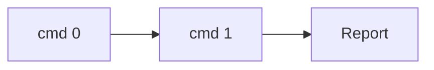
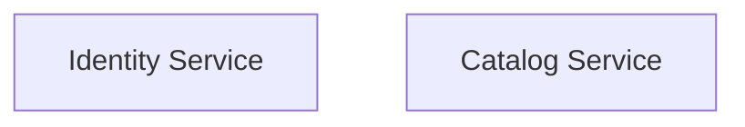

# {source} — Reverse Engineering Report

> Evidence tags on every claim: `[obs]` observation · `[der]` derivation · `[inf]` inference · `[unk]` unknown.
> This template is format-agnostic: it renders whatever the evidence bundle
> contains, for any target (APK, native binary, web app, pcap, …). No
> target-specific sections. Sections `5.2`/`5.3` are emitted only when their
> data is non-empty; all other headings are fixed.
> Generated by `scripts/lib/report.mjs` from the bundle in `scripts/lib/evidence-schema.json`.

## 1. Abstract

One paragraph: the target (`source`, `format`), the recorded evidence volume
(facts by class, systems, data-flow entries, artifacts). No detail yet.

## 2. Objective & Motivation

The question this analysis answers for `{source}` and why it matters. State
the evidence ceiling explicitly: `[inf]`/`[unk]` claims are not established by
observation and are listed in section 6.

## 3. Pre-requisites & Tools

| Tool   | Status    |
| ------ | --------- |
| jadx   | available |
| ghidra | missing   |

Built from `readiness.available` / `readiness.missing`. State the effect of
each gap on confidence.

## 4. Method / Framework / Flow

List the `run.commands` that were executed, then the pipeline:

## 5. Results

### 5.1 Facts

One table, rows grouped by `facts[].category`:

| id  | category | claim                                | evidence_class | source  |
| --- | -------- | ------------------------------------ | -------------- | ------- |
| f1  | network  | POST /v1/auth sends\|receives tokens | `[obs]`        | capture |

### 5.2 Systems / architecture

Emitted only when `systems[]` is non-empty. One box per system, labelled with
its name:

### 5.3 Data flows

Emitted only when at least one of `flows.upstream` / `flows.downstream` /
`flows.telemetry` is non-empty. Each non-empty array becomes one table whose
columns are the union of the entries' keys:

#### Upstream

| endpoint      | payload               |
| ------------- | --------------------- |
| POST /v1/auth | device_id, phone, OTP |

#### Downstream

#### Telemetry

### 5.4 Artifacts

A list of `artifacts[].kind` + `path`.

## 6. Limitations & unknowns

All facts whose `evidence_class` is `inf` or `unk`, listed. Everything that
could not be verified, and what would raise confidence.

## 7. Conclusion & recommendations

Recommendations grounded in the results. No sales tone. Each recommendation
references the finding that motivates it and respects the section 6 limits.
