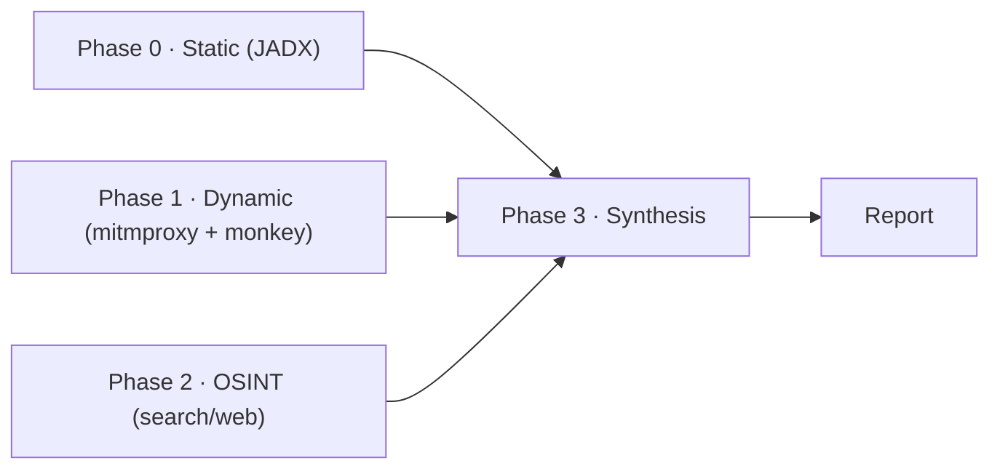
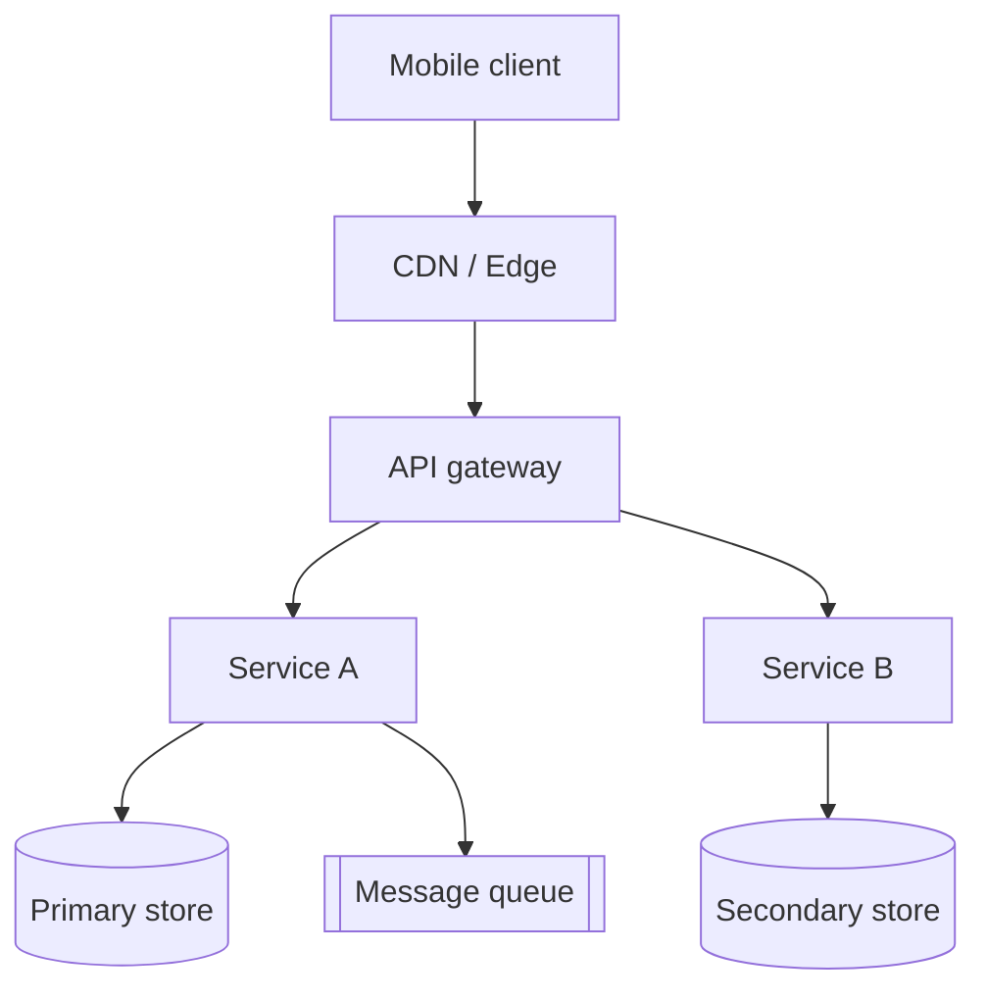
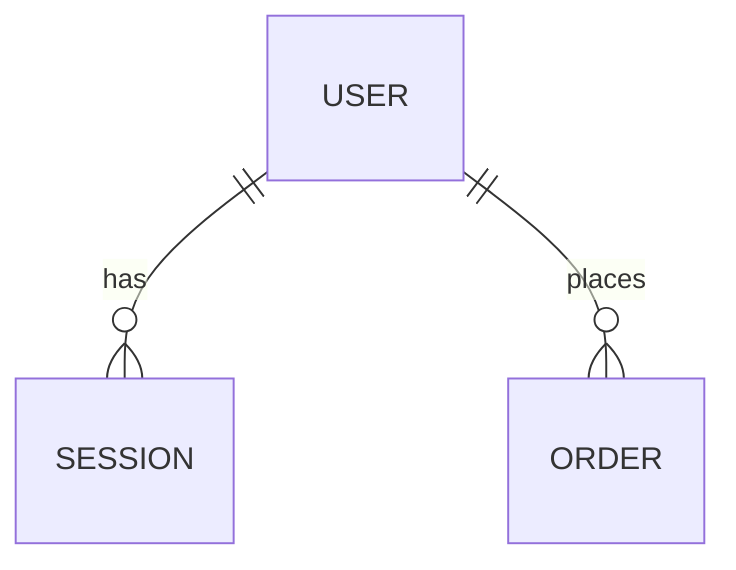

# {Product Name} — Architecture & Product Teardown

> Evidence tags on every claim: `[obs]` observation · `[der]` derivation · `[inf]` inference · `[unk]` unknown.
> Fill the `{...}` placeholders per target; mark sections with no evidence `[unk]` rather than deleting them.
> The data-flow inventory (5.4) follows [data-flow-inventory.md](data-flow-inventory.md).

## 1. Abstract

One paragraph: what the product is, its core function, and the two or three most
important architecture and stack findings. No detail yet.

## 2. Objective & Motivation

The question this analysis answers (e.g. "how is {Product} architected and where
does it scale-break") and why it matters (founder-level conversation). State the
evidence available and its ceiling explicitly.

## 3. Pre-requisites & Tools

| Tool                                 | Purpose                    | Available? |
| ------------------------------------ | -------------------------- | ---------- |
| REA `inspect_android_package` (JADX) | static APK analysis        | yes/no     |
| REA `inspect_web_network_capture`    | traffic capture inspection | yes/no     |
| adb + emulator/AVD                   | dynamic execution          | yes/no     |
| mitmdump                             | proxy capture              | yes/no     |
| search/web tool                      | OSINT                      | yes/no     |

List what was and was not available, and the effect of each gap on confidence.

## 4. Method / Framework / Flow

Four phases, with the flow diagram below. Describe each phase's inputs/outputs.

## 5. Results

### 5.1 Product overview & positioning

What it is, who it serves, the surface area (platforms, feature families).
Tag each fact with its evidence class.

### 5.2 Feature inventory (MECE)

One table, grouped by a fixed taxonomy with no overlap and no gap:
onboarding / core loop / social / commerce / notifications / settings /
admin & ops / infra-adjacent. Each row: feature name, what it does, evidence
source, evidence class.

| Group      | Feature | What it does              | Source               | Class   |
| ---------- | ------- | ------------------------- | -------------------- | ------- |
| onboarding | sign-up | email/phone + social auth | manifest + endpoints | `[obs]` |

### 5.3 Client-side → server-side mapping

For each client artifact (API endpoint, SDK, GraphQL query, embedded config):
what it implies about the backend. A table, one row per artifact.

| Client artifact       | Server-side implication           | Class   |
| --------------------- | --------------------------------- | ------- |
| `POST /v1/auth/token` | identity service + token issuance | `[obs]` |

### 5.4 Data flow & permission inventory

The bidirectional inventory — what the client captures and sends up, what the
server sends back, and what that implies. Follow
[data-flow-inventory.md](data-flow-inventory.md).

#### 5.4.1 Permissions → data captured (upstream source)

| Permission             | Data unlocked | Requested? | Likely server purpose          | Class           |
| ---------------------- | ------------- | ---------- | ------------------------------ | --------------- |
| `ACCESS_FINE_LOCATION` | GPS location  | yes        | serviceability / nearest store | `[obs]`/`[der]` |

#### 5.4.2 Client → Server transmission (what's sent, and how much)

| Endpoint / event      | Payload fields sent   | Volume / history signal | Class   |
| --------------------- | --------------------- | ----------------------- | ------- |
| `POST /v1/auth/token` | device id, phone, OTP | one-shot                | `[obs]` |

Note the volume/history signals (pagination `page`/`limit`/`cursor`, sync
`since`/`updated_after`, history-list depth, batch endpoints). These are
`[inf]` — server retention is never observable from the client.

#### 5.4.3 Server → Client payloads (the main information flown)

| Response payload            | Main information it carries  | Class   |
| --------------------------- | ---------------------------- | ------- |
| widget tree (`WidgetModel`) | server-driven UI composition | `[obs]` |

#### 5.4.4 Telemetry / SDK capture (silent upstream)

| SDK       | What it captures               | Class   |
| --------- | ------------------------------ | ------- |
| AppsFlyer | install attribution, deep-link | `[obs]` |

### 5.5 Architecture (HLD) — derived from data flow

Each box below must be traceable to a flow cluster from 5.4 (identity ← auth
tokens; catalog ← product/inventory; ETA ← per-asset ETA; recommendation ←
ranked rails; logistics ← order status; analytics ← telemetry). Tag each box
`[der]` (follows from flows) or `[inf]` (plausible).

Narrative: name each service, state the flow that implies it, and its evidence
class. Explicitly separate what is observed from what is inferred.

### 5.6 Third-party SaaS matrix (build vs. buy)

| Concern   | Provider   | Evidence        | Build or buy |
| --------- | ---------- | --------------- | ------------ |
| analytics | (SDK name) | SDK in manifest | buy          |

### 5.7 Inferred data model

Entities and relationships, each annotated with the JSON keys / GraphQL types
that imply them, and the confidence level.

### 5.8 How & why

For each major feature: the likely implementation and the engineering rationale
(e.g. WebSocket over polling for realtime, GraphQL for a varied mobile surface,
CDN for media). Mark rationale as `[inf]` unless evidenced.

### 5.9 Scaling & risk observations

Bottlenecks, single points of failure, and growth constraints. Separate
`[obs]`/`[der]` from `[inf]`/`[unk]`.

## 6. Limitations & unknowns

Everything that could not be verified (e.g. pinned HTTPS traffic, hidden
internal services, exact data store choices, server-side data retention). Be
explicit about what would raise confidence.

## 7. Conclusion & recommendations

Architectural recommendations grounded in the results. No sales or founder-pitch
tone. Each recommendation references the finding that motivates it.
