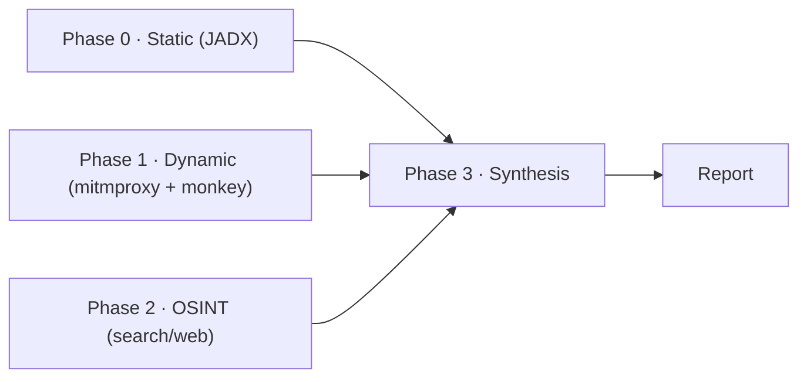
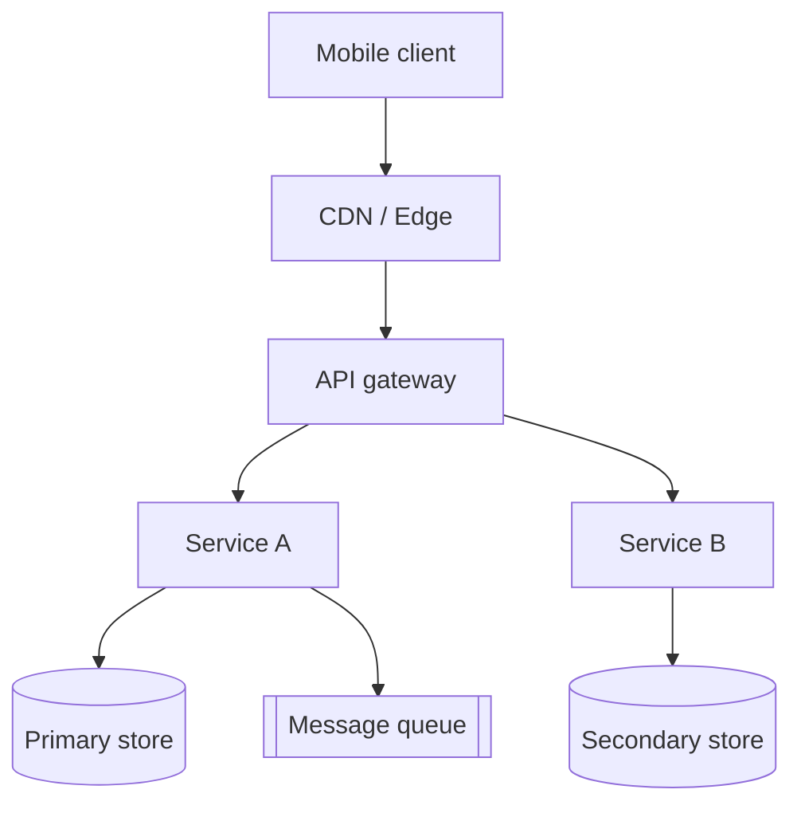
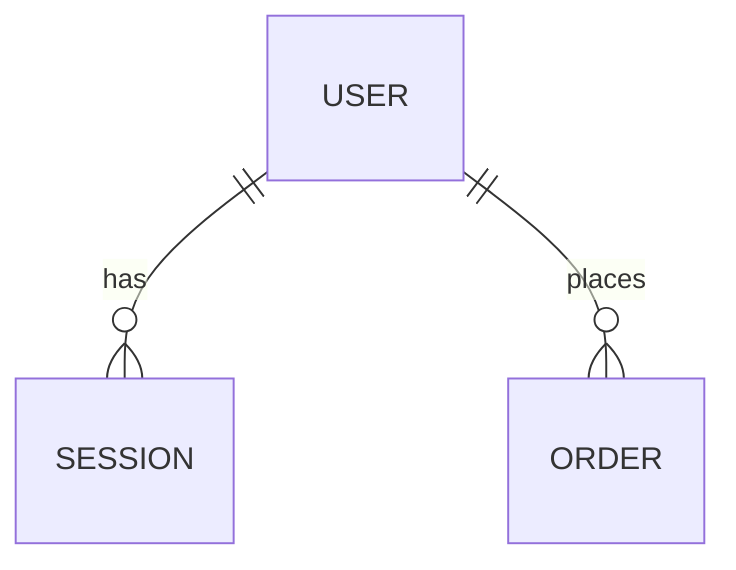

# Startup Product Intelligence Workflow Implementation Plan

> **For agentic workers:** REQUIRED SUB-SKILL: Use superpowers:subagent-driven-development (recommended) or superpowers:executing-plans to implement this plan task-by-task. Steps use checkbox (`- [ ]`) syntax for tracking.

**Goal:** Build the missing "orchestration glue" for REA — a best-effort Android dynamic-traffic capture script plus a `rea-startup-intel` skill that turns a startup's APK + public footprint into a scientific-method Architecture & Product Teardown report.

**Architecture:** A standalone bash script drives `adb` + `mitmdump` + `monkey` to capture traffic (`.mitm` + `.har`), then a new skill orchestrates four phases — Static (JADX) → Dynamic (capture) → OSINT (search) → Synthesis (report) — reusing REA's existing `inspect_android_package` and `inspect_web_network_capture` tools. No REA source changes, no new provider, no Python MCP.

**Tech Stack:** bash (script), markdown + mermaid (skill + report template). Existing: REA MCP tools, caller-supplied `adb`/`mitmdump`/`emulator`.

---

## File Structure

- Create `.agents/skills/rea-startup-intel/SKILL.md` — skill frontmatter + four-phase workflow.
- Create `.agents/skills/rea-startup-intel/references/report-template.md` — the MECE report template with mermaid skeletons.
- Create `.agents/skills/rea-startup-intel/scripts/capture-apk-traffic.sh` — the sandbox capture script.
- Create `tests/rea-startup-intel/capture-apk-traffic.test.sh` — runnable self-check for the script's pure functions.

All skill files live under `.agents/skills/` (the source root; `skills/` is a generated output). The test lives in `tests/` alongside the existing test layout.

---

### Task 1: Report template reference

**Files:**

- Create: `.agents/skills/rea-startup-intel/references/report-template.md`

- [ ] **Step 1: Create the report template**

Write `.agents/skills/rea-startup-intel/references/report-template.md` with this exact content:

````markdown
# {Product Name} — Architecture & Product Teardown

> Evidence tags on every claim: `[obs]` observation · `[der]` derivation · `[inf]` inference · `[unk]` unknown.
> Fill the `{...}` placeholders per target; delete sections that have no evidence.

## 1. Abstract

One paragraph: what the product is, its core function, and the two or three most
important architecture and stack findings. No detail yet.

## 2. Objective & Motivation

The question this analysis answers (e.g. "how is {Product} architected and where
does it scale-break") and why it matters (founder-level conversation). State the
evidence available and its ceiling explicitly.

## 3. Pre-requisites & Tools

| Tool                                 | Purpose                    | Available? |
| ------------------------------------ | -------------------------- | ---------- |
| REA `inspect_android_package` (JADX) | static APK analysis        | yes/no     |
| REA `inspect_web_network_capture`    | traffic capture inspection | yes/no     |
| adb + emulator/AVD                   | dynamic execution          | yes/no     |
| mitmdump                             | proxy capture              | yes/no     |
| search/web tool                      | OSINT                      | yes/no     |

List what was and was not available, and the effect of each gap on confidence.

## 4. Method / Framework / Flow

Four phases, with the flow diagram below. Describe each phase's inputs/outputs.



## 5. Results

### 5.1 Product overview & positioning

What it is, who it serves, the surface area (platforms, feature families).
Tag each fact with its evidence class.

### 5.2 Feature inventory (MECE)

One table, grouped by a fixed taxonomy with no overlap and no gap:
onboarding / core loop / social / commerce / notifications / settings /
admin & ops / infra-adjacent. Each row: feature name, what it does, evidence
source, evidence class.

| Group      | Feature | What it does              | Source               | Class   |
| ---------- | ------- | ------------------------- | -------------------- | ------- |
| onboarding | sign-up | email/phone + social auth | manifest + endpoints | `[obs]` |

### 5.3 Client-side → server-side mapping

For each client artifact (API endpoint, SDK, GraphQL query, embedded config):
what it implies about the backend. A table, one row per artifact.

| Client artifact       | Server-side implication           | Class   |
| --------------------- | --------------------------------- | ------- |
| `POST /v1/auth/token` | identity service + token issuance | `[obs]` |

### 5.4 Architecture (HLD)



Narrative describing each box, its ownership, and the evidence (or inference)
behind it.

### 5.5 Third-party SaaS matrix (build vs. buy)

| Concern   | Provider   | Evidence        | Build or buy |
| --------- | ---------- | --------------- | ------------ |
| analytics | (SDK name) | SDK in manifest | buy          |

### 5.6 Inferred data model



Entities and relationships, each annotated with the JSON keys / GraphQL types
that imply them, and the confidence level.

### 5.7 How & why

For each major feature: the likely implementation and the engineering rationale
(e.g. WebSocket over polling for realtime, GraphQL for a varied mobile surface,
CDN for media). Mark rationale as `[inf]` unless evidenced.

### 5.8 Scaling & risk observations

Bottlenecks, single points of failure, and growth constraints. Separate
`[obs]`/`[der]` from `[inf]`/`[unk]`.

## 6. Limitations & unknowns

Everything that could not be verified (e.g. pinned HTTPS traffic, hidden
internal services, exact data store choices). Be explicit about what would
raise confidence.

## 7. Conclusion & recommendations

Architectural recommendations grounded in the results. No sales or founder-pitch
tone. Each recommendation references the finding that motivates it.
````

- [ ] **Step 2: Verify the template exists and renders**

Run: `test -f .agents/skills/rea-startup-intel/references/report-template.md && grep -c '^## ' .agents/skills/rea-startup-intel/references/report-template.md`
Expected: prints the file path check as success, and `8` (sections 1–7 plus "Results" subsections are not `## `; the eight `## ` headings are 1..7 + none extra — expect `7`).

Note: if the count is `7`, that is correct (sections 1 through 7). Verify the file contains the mermaid fences:

Run: `grep -c '```mermaid' .agents/skills/rea-startup-intel/references/report-template.md`
Expected: `4` (flow, HLD, ER, and the Method flow — actually 3 mermaid blocks: Method flow, HLD, ER diagram). Confirm `3`.

- [ ] **Step 3: Commit**

```bash
git add .agents/skills/rea-startup-intel/references/report-template.md
git commit -m "docs(rea-startup-intel): add MECE report template"
```

---

### Task 2: Dynamic capture script

**Files:**

- Create: `tests/rea-startup-intel/capture-apk-traffic.test.sh`
- Create: `.agents/skills/rea-startup-intel/scripts/capture-apk-traffic.sh`

- [ ] **Step 1: Write the failing test**

Write `tests/rea-startup-intel/capture-apk-traffic.test.sh`:

```bash
#!/usr/bin/env bash
set -euo pipefail

SCRIPT_DIR="$(cd "$(dirname "${BASH_SOURCE[0]}")" && pwd)"
SRC="$SCRIPT_DIR/../../.agents/skills/rea-startup-intel/scripts/capture-apk-traffic.sh"
source "$SRC"

failures=0

# require_bin rejects a missing binary
if require_bin "definitely-not-a-real-bin-xyz" 2>/dev/null; then
  echo "FAIL: require_bin accepted a missing binary"; failures=$((failures+1))
else
  echo "PASS: require_bin rejects missing binary"
fi

# parse_args rejects missing required args
APK_PATH=""; PACKAGE_NAME=""; OUTPUT_DIR=""
if ( parse_args --apk /tmp/x.apk ) 2>/dev/null; then
  echo "FAIL: parse_args accepted missing --package/--output"; failures=$((failures+1))
else
  echo "PASS: parse_args rejects missing required args"
fi

# parse_args rejects a non-existent APK path
APK_PATH=""; PACKAGE_NAME=""; OUTPUT_DIR=""
if ( parse_args --apk /tmp/does-not-exist.apk --package a.b --output /tmp/o ) 2>/dev/null; then
  echo "FAIL: parse_args accepted a missing APK file"; failures=$((failures+1))
else
  echo "PASS: parse_args rejects missing APK file"
fi

# usage lists required flags
if ! usage 2>/dev/null | grep -q -- '--apk'; then
  echo "FAIL: usage missing --apk"; failures=$((failures+1))
else
  echo "PASS: usage lists required flags"
fi

exit "$failures"
```

- [ ] **Step 2: Run the test to verify it fails**

Run: `bash tests/rea-startup-intel/capture-apk-traffic.test.sh`
Expected: FAIL — the `source "$SRC"` line errors because the script does not exist yet ("No such file or directory").

- [ ] **Step 3: Write the script**

Write `.agents/skills/rea-startup-intel/scripts/capture-apk-traffic.sh`:

```bash
#!/usr/bin/env bash
# Best-effort dynamic traffic capture for an Android APK.
# Drives the app with monkey while mitmdump records; finalizes .mitm and .har.
set -euo pipefail

APK_PATH=""
PACKAGE_NAME=""
OUTPUT_DIR=""
AVD_NAME=""
EVENT_COUNT=500
PORT=8080
CHECK_ONLY=0
SERIAL=""

ADB_BIN="${ADB_BIN:-adb}"
EMULATOR_BIN="${EMULATOR_BIN:-emulator}"
MITMDUMP_BIN="${MITMDUMP_BIN:-mitmdump}"

PROXY_PID=""

usage() {
  cat <<'EOF'
Usage: capture-apk-traffic.sh --apk PATH --package PKG --output DIR [options]

Required:
  --apk PATH       Absolute path to the APK to install.
  --package PKG    Android package id (e.g. com.acme.app).
  --output DIR     Output directory; receives traffic.mitm and traffic.har.

Options:
  --avd NAME       Boot this AVD; otherwise attach to the running device.
  --events N       Monkey UI event count (default 500).
  --port N         mitmdump listen port (default 8080).
  --check          Dry-run: validate prerequisites and print the plan, then exit.
  --help           Show this message.

Environment overrides:
  ADB_BIN, EMULATOR_BIN, MITMDUMP_BIN (default: resolved from PATH).
EOF
}

die() { printf 'error: %s\n' "$*" >&2; exit 1; }

require_bin() {
  local bin="$1"
  if ! command -v "$bin" >/dev/null 2>&1; then
    die "missing prerequisite '$bin'; install it or set the corresponding *_BIN override"
  fi
}

parse_args() {
  while [[ $# -gt 0 ]]; do
    case "$1" in
      --apk) APK_PATH="${2:-}"; shift 2 ;;
      --package) PACKAGE_NAME="${2:-}"; shift 2 ;;
      --output) OUTPUT_DIR="${2:-}"; shift 2 ;;
      --avd) AVD_NAME="${2:-}"; shift 2 ;;
      --events) EVENT_COUNT="${2:-}"; shift 2 ;;
      --port) PORT="${2:-}"; shift 2 ;;
      --check) CHECK_ONLY=1; shift ;;
      --help) usage; exit 0 ;;
      *) die "unknown argument: $1" ;;
    esac
  done

  [[ -n "$APK_PATH" ]] || die "--apk is required"
  [[ -n "$PACKAGE_NAME" ]] || die "--package is required"
  [[ -n "$OUTPUT_DIR" ]] || die "--output is required"
  [[ -f "$APK_PATH" ]] || die "APK not found: $APK_PATH"
  [[ "$EVENT_COUNT" =~ ^[0-9]+$ ]] || die "--events must be a non-negative integer"
  [[ "$PORT" =~ ^[0-9]+$ ]] || die "--port must be an integer"
}

device_serial() {
  "$ADB_BIN" devices | awk 'NR>1 && $2=="device" {print $1; exit}'
}

start_device() {
  if [[ -n "$AVD_NAME" ]]; then
    "$EMULATOR_BIN" -avd "$AVD_NAME" -no-snapshot-load >/dev/null 2>&1 &
  fi
  local i
  for i in $(seq 1 120); do
    local serial
    serial="$(device_serial)" || true
    if [[ -n "$serial" ]]; then
      "$ADB_BIN" -s "$serial" wait-for-device >/dev/null 2>&1
      return 0
    fi
    sleep 1
  done
  die "no device became available after 120s"
}

wait_port() {
  local i
  for i in $(seq 1 30); do
    if (exec 3<>"/dev/tcp/127.0.0.1/$PORT") 2>/dev/null; then
      exec 3>&- 3<&- 2>/dev/null || true
      return 0
    fi
    sleep 0.2
  done
  die "mitmdump did not bind port $PORT"
}

start_proxy() {
  mkdir -p "$OUTPUT_DIR"
  "$MITMDUMP_BIN" --mode regular --listen-host 127.0.0.1 --listen-port "$PORT" \
    -w "$OUTPUT_DIR/traffic.mitm" \
    --set "hardump=$OUTPUT_DIR/traffic.har" \
    >"$OUTPUT_DIR/mitmdump.log" 2>&1 &
  PROXY_PID=$!
  wait_port
}

route_device() {
  local serial="$1"
  "$ADB_BIN" -s "$serial" reverse "tcp:$PORT" "tcp:$PORT" >/dev/null 2>&1
  "$ADB_BIN" -s "$serial" shell settings put global http_proxy "127.0.0.1:$PORT" >/dev/null 2>&1
}

install_and_drive() {
  local serial="$1"
  "$ADB_BIN" -s "$serial" install -r "$APK_PATH" >/dev/null 2>&1 || die "adb install failed"
  # monkey may exit non-zero on some devices; traffic is already captured, so do not fail.
  timeout 600 "$ADB_BIN" -s "$serial" shell monkey \
    -p "$PACKAGE_NAME" -c android.intent.category.LAUNCHER -v "$EVENT_COUNT" \
    || true
}

cleanup() {
  if [[ -n "$SERIAL" ]]; then
    "$ADB_BIN" -s "$SERIAL" shell settings put global http_proxy ":0" >/dev/null 2>&1 || true
    "$ADB_BIN" -s "$SERIAL" reverse --remove "tcp:$PORT" >/dev/null 2>&1 || true
  fi
  if [[ -n "$PROXY_PID" ]] && kill -0 "$PROXY_PID" 2>/dev/null; then
    kill "$PROXY_PID" 2>/dev/null || true
    wait "$PROXY_PID" 2>/dev/null || true
    PROXY_PID=""
  fi
}

emit_report() {
  printf 'capture complete\n'
  printf '  package: %s\n' "$PACKAGE_NAME"
  printf '  flow:    %s/traffic.mitm\n' "$OUTPUT_DIR"
  printf '  har:     %s/traffic.har\n' "$OUTPUT_DIR"
  printf '\nNext: inspect_web_network_capture %s/traffic.mitm mitmproxy\n' "$OUTPUT_DIR"
}

main() {
  parse_args "$@"
  require_bin "$ADB_BIN"
  require_bin "$MITMDUMP_BIN"
  [[ -n "$AVD_NAME" ]] && require_bin "$EMULATOR_BIN"

  if [[ "$CHECK_ONLY" -eq 1 ]]; then
    printf 'check passed: prerequisites present\n'
    printf 'would capture APK=%s package=%s to %s with %s events on port %s\n' \
      "$APK_PATH" "$PACKAGE_NAME" "$OUTPUT_DIR" "$EVENT_COUNT" "$PORT"
    exit 0
  fi

  local serial
  start_device
  serial="$(device_serial)"
  [[ -n "$serial" ]] || die "could not resolve device serial"
  SERIAL="$serial"
  trap cleanup EXIT

  start_proxy
  route_device "$serial"
  install_and_drive "$serial"
  cleanup
  trap - EXIT
  emit_report
}

if [[ "${BASH_SOURCE[0]}" == "${0}" ]]; then
  main "$@"
fi
```

- [ ] **Step 4: Make it executable**

Run: `chmod +x .agents/skills/rea-startup-intel/scripts/capture-apk-traffic.sh`

- [ ] **Step 5: Run the test to verify it passes**

Run: `bash tests/rea-startup-intel/capture-apk-traffic.test.sh`
Expected: four `PASS:` lines and exit code `0`.

- [ ] **Step 6: Run the built-in dry-run check**

Run: `ADB_BIN=true MITMDUMP_BIN=true EMULATOR_BIN=true bash .agents/skills/rea-startup-intel/scripts/capture-apk-traffic.sh --apk /tmp/x.apk --package a.b --output /tmp/o --check`
Expected: `check passed: prerequisites present` then the "would capture" line, exit `0`.

Note: `--apk /tmp/x.apk` must exist for this to pass. Create it first with `touch /tmp/x.apk`.

- [ ] **Step 7: Commit**

```bash
git add tests/rea-startup-intel/capture-apk-traffic.test.sh .agents/skills/rea-startup-intel/scripts/capture-apk-traffic.sh
git commit -m "feat(rea-startup-intel): add best-effort APK traffic capture script"
```

---

### Task 3: Skill entry point

**Files:**

- Create: `.agents/skills/rea-startup-intel/SKILL.md`

- [ ] **Step 1: Write the skill**

Write `.agents/skills/rea-startup-intel/SKILL.md`:

```markdown
---
name: rea-startup-intel
description: Reverse engineer a startup's mobile product into a scientific-method Architecture & Product Teardown report for a founder-level conversation. Combines static APK analysis (JADX), best-effort dynamic traffic capture (mitmproxy + monkey), and OSINT. Use when the goal is product/backend understanding to pitch ideas, not source-level decompilation.
---

# REA Startup Product Intelligence

Produce a scientific-method report — Abstract → Objective/Motivation →
Pre-requisites/Tools → Method → Results (MECE) → Limitations → Conclusion —
giving a holistic view of a startup's mobile product: feature inventory,
client→server mapping, architecture (HLD), third-party SaaS, inferred data
model, and how/why each major feature is built.

Use this skill when the target is a startup's **product** (mobile app + backend

- public footprint) and the goal is understanding to hold a founder-level
  conversation. For source-level decompilation itself, use
  `reverse-engineer-anything` instead.

## Prerequisites

- REA MCP tools available: `inspect_android_package`, `inspect_web_network_capture`, and the adb family.
- A search/web tool (brave-search or web fetch) for OSINT.
- For dynamic capture: caller-supplied `adb`, `mitmdump`, and an AVD/device. The script never installs them.

## Workflow

### Phase 0 — Static analysis (JADX)

Run `inspect_android_package` on the APK. Record: API endpoints, third-party
SDKs, embedded GraphQL/keys, manifest components, and the feature surface.
Tag each finding `[obs]` (seen) or `[der]` (derived).

### Phase 1 — Dynamic capture (best-effort)

Run `scripts/capture-apk-traffic.sh --apk <path> --package <pkg> --output <dir>`.
Then `inspect_web_network_capture <dir>/traffic.mitm mitmproxy` (or
`<dir>/traffic.har har`) to extract domains, third-party SaaS, and any captured
bodies. Expect limited coverage: many apps pin certificates or ignore the
system proxy.

### Phase 2 — OSINT

Search `site:lever.co | site:greenhouse.io "<company>" engineer`, funding/stage
news, engineering blog, GitHub org, StackShare/BuiltWith. Extract stack signals.

### Phase 3 — Synthesis

Fill in [report-template](references/report-template.md). Tag every claim with
its evidence class (`[obs]`/`[der]`/`[inf]`/`[unk]`). Do not invent facts; mark
unconfirmed reasoning `[inf]` and unknowns `[unk]`.

## Output

A markdown report saved to the analysis directory, following the template.
```

- [ ] **Step 2: Verify frontmatter parses**

Run: `head -4 .agents/skills/rea-startup-intel/SKILL.md`
Expected: the `---` fence, `name: rea-startup-intel`, and `description:` line present.

- [ ] **Step 3: Commit**

```bash
git add .agents/skills/rea-startup-intel/SKILL.md
git commit -m "feat(rea-startup-intel): add startup product intelligence skill"
```

---

### Task 4: Verification

**Files:**

- (none new; validates the three committed artifacts)

- [ ] **Step 1: Re-run the script test**

Run: `bash tests/rea-startup-intel/capture-apk-traffic.test.sh`
Expected: four `PASS:` lines, exit `0`.

- [ ] **Step 2: Shellcheck (if available)**

Run: `command -v shellcheck >/dev/null && shellcheck .agents/skills/rea-startup-intel/scripts/capture-apk-traffic.sh || echo "shellcheck not installed; skipped"`
Expected: no warnings, or `shellcheck not installed; skipped`.

- [ ] **Step 3: Confirm skill files are discoverable**

Run: `ls -R .agents/skills/rea-startup-intel`
Expected: `SKILL.md`, `references/report-template.md`, `scripts/capture-apk-traffic.sh`.

- [ ] **Step 4: Final commit (if any changes)**

```bash
git status --short
```

If clean, done. If shellcheck/formatting changed anything, commit with:

```bash
git add -A && git commit -m "chore(rea-startup-intel): verify and lint capture workflow"
```

---

## Self-Review

- **Spec coverage:** Component 1 (script) → Task 2. Component 2 (skill) → Task 3. Component 3 (report template) → Task 1. Constraints (bring-your-own, no provider, HTTPS best-effort) → encoded in script `require_bin`/`--check` and SKILL.md Prerequisites. Evidence discipline → report template header + SKILL.md Phase 3. Testing → Task 2 test + Task 4. All spec sections mapped.
- **Placeholders:** None. `{Product Name}`/`{...}` in the template are intentional template variables, not plan gaps.
- **Type consistency:** `parse_args`, `require_bin`, `usage`, `cleanup`, `device_serial` names are identical between the script and the test that sources it. `traffic.mitm`/`traffic.har` naming matches the SKILL.md Phase 1 references.
